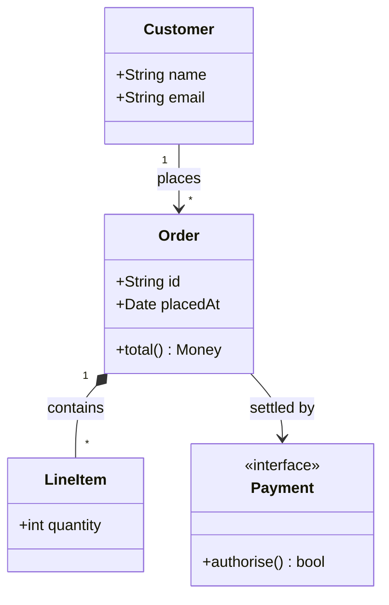

# Technical Report: Refactoring

## Requirements

<!--
Briefly describe the major functional requirements of your project.
- Identify what the system should do.
- Make each requirement clear and testable.
- Use requirement IDs (e.g., R1, R2, R3) for reference.
-->

- R1: Reads and validates `Elf64_Ehdr.e_ident` for magic number, class, data endianness, version, and machine architecture (supports little-endian, x86-64).
- R2: Creates an `ElfHeader` object from a valid ELF binary with all fields populated.
- R3: Reads section size and offset for all section headers present in binary.
- R4: Reads section names from the section name table for all section headers present in binary, failing safely with empty strings if the section name table index is `SHN_UNDEF`.
- R5: 

## System Design

<!--
Describe how you plan to organize your project using C++ classes. Your design should include:

- **Major classes:** Explain the responsibility, important data members, and main functions/interfaces of each class.
- **Class relationships:** Provide a UML class diagram or equivalent diagram showing how the classes are related (e.g., composition, inheritance, or usage).
- **Class interactions:** Explain how the classes work together to implement the major system functionality.

Include representative C++ class declarations where helpful.

Focus on explaining **how your design satisfies the requirements**, rather than simply listing classes and functions.
-->

## Test Design

<!--
Design tests to verify the major requirements and system functionality. For each test, provide:

- **Target:** The requirement or component being tested.
- **Input/Setup:** The input or conditions required.
- **Expected Result:** The expected behavior or output.

Include normal cases and important error/edge cases.

Briefly explain how your planned tests cover the major requirements.

You only need to design the tests in this milestone. They will be implemented and executed in the final milestone.
-->
