# Technical Report: Refactoring
## 0. Overview
This report presents the proposed object-oriented design for an ELF Binary Inspector. The application receives a binary file, validates and reads its metadata, then prints a concise inspection report. The design prioritizes clear ownership, validation, and testability.

This report explains the main requirements of the program, technical details of how those requirements are met including our proposed object-oriented architecture, and details of how those requirements are tested. This report solely deals with design, which will be implemented in a further step.

## 1. Requirements

| ID | Requirement |
|---|---|
| R1 | Reads and validates ELF header for magic number, class, data endianness, version, and machine architecture (supports little-endian, x86-64). |
| R2 | Reads section headers from the section header table, validating the table's offset, count, and entry size against the file bounds. |
| R3 | Reads section names from the section name table for all section headers present in binary, failing safely with empty strings if the section name table index is `SHN_UNDEF`. |
| R4 | Reads program headers from the program header table, validating the table's offset, count, and entry size against the file bounds. |
| R5 | Reads program type, offset, virtual address, file size, and memory size. |
| R6 | Prints endianness, machine architecture, class, counts, sizes, and offsets for program headers and section headers from ELF header according to the format below. |
| R7 | Prints index, name, offset, and size for all sections according to the format below. |
| R8 | Prints index, type, offset, virtual address, file size, memory size, memory access permissions, and alignment for all program headers according to the format below. |

### Example print output

```
FBinaryInspector.exe sample.elf 
File: sample.elf
ELF64 | little-endian | x86-64 | DYN | Entry: 0x000000
Program headers: offset=0x000040, entry_size=56, count=9
Section headers: offset=0x0004c0, entry_size=64, count=14

Sections
INDEX   NAME            OFFSET        SIZE_BYTES
0                       0x000000      0
1       .interp         0x000238      28
2       .dynsym         0x000258      24
3       .gnu.hash       0x000270      28
4       .dynstr         0x00028c      1
5       .eh_frame_hdr   0x000290      20
6       .eh_frame       0x0002a8      60
7       .text           0x0002f0      18
8       .dynamic        0x000308      128
9       .relro_padding  0x000388      3192
10      .comment        0x000388      59
11      .symtab         0x0003c8      96
12      .shstrtab       0x000428      124
13      .strtab         0x0004a4      23

Program headers
IDX   TYPE            OFFSET      VADDR      FILE_B    MEM_B   R/W/X   ALIGN
0     PHDR            0x000040    0x000040   504       504     R--     0x000008
1     INTERP          0x000238    0x000238   28        28      R--     0x000001
2     LOAD            0x000000    0x000000   740       740     R--     0x001000
3     LOAD            0x0002f0    0x0012f0   18        18      R-X     0x001000
4     LOAD            0x000308    0x002308   128       3320    RW-     0x001000
5     DYNAMIC         0x000308    0x002308   128       128     RW-     0x000008
6     0x6474e552      0x000308    0x002308   128       3320    R--     0x000001
7     0x6474e550      0x000290    0x000290   20        20      R--     0x000004
8     0x6474e551      0x000000    0x000000   0         0       RW-     0x000000
```

## System Design

`FileBuffer` owns the bytes read from the input path and exposes a read-only byte span. `ElfHeader`, `Section`, and `Segment` are value objects: they retain only validated metadata (including offsets and sizes), not pointers into the input buffer. `ElfBinary` owns one header plus its vectors of sections and segments, giving the printer one complete, valid model to inspect.

`ElfHeaderReader` validates the ELF identity and supported target, then returns an `ElfHeader` (R1). `SectionTableReader` and `ProgramHeaderTableReader` validate each table's offset, count, entry size, and referenced data ranges before producing value objects (R2, R4, and R5). `ElfBinaryReader` coordinates those readers: `FileBuffer` supplies bytes, the header is read first, then the two tables are read, and any validation failure prevents an `ElfBinary` from being returned.

After a successful read, `SectionNameResolverFactory` selects a name-resolution strategy from the header. `SectionHeaderStringTable` uses the validated string-table section to resolve each section's stored `name_offset`; `EmptySectionNameResolver` returns empty names for `SHN_UNDEF` (R3). Finally, `ElfBinaryPrinter` receives the complete model, original read-only bytes, and resolver to print the header, section rows, and program-header rows (R6–R8). This separates parsing, model construction, name lookup, and formatting so each can be tested independently.

### Optional Bonus

R3 requires empty names when the section-name table index is undefined. The **Strategy pattern** lets `Section` delegate name lookup to `ISectionNameResolver`: `SectionHeaderStringTable` resolves offsets through a valid string table, while `EmptySectionNameResolver` handles `SHN_UNDEF`. The **Factory pattern** confines the choice of strategy to `SectionNameResolverFactory`. This avoids conditional name-resolution logic in both `Section` and `ElfBinaryPrinter`, while allowing future resolver types without changing them.

```mermaid
classDiagram
  class FileBuffer {
    +FileBuffer(path path)
    +bytes() span~const byte~
    -vector~byte~ data
  }
  class ElfBinary {
    +ElfHeader header
    +vector~Section~ sections
    +vector~Segment~ segments
  }
  class ElfHeader {
    +uint16_t type
    +uint64_t entry
    +uint64_t program_header_offset
    +uint16_t program_header_entry_size
    +uint16_t program_header_count
    +uint64_t section_header_offset
    +uint16_t section_header_entry_size
    +uint16_t section_header_count
    +uint16_t section_name_table_index
  }
  class Section {
    +uint32_t index
    +uint32_t name_offset
    +uint64_t offset
    +uint64_t size
    +body(span~const byte~ file) span~const byte~
    +get_name(span~const byte~ file, ISectionNameResolver& resolver) string
    -optional~string~ cached_name
  }
  class ISectionNameResolver {
    <<interface>>
    +name_at(span~const byte~ file, uint32_t offset) string_view
  }
  class SectionHeaderStringTable {
    +SectionHeaderStringTable(const Section& section)
    +name_at(span~const byte~ file, uint32_t offset) string_view
    -const Section* section
  }
  class EmptySectionNameResolver {
    +name_at(span~const byte~ file, uint32_t offset) string_view
  }
  class SectionNameResolverFactory {
    +create(const ElfBinary& binary) unique_ptr~ISectionNameResolver~
  }
  class Segment {
    +uint32_t index
    +uint32_t type
    +uint32_t flags
    +uint64_t offset
    +uint64_t virtual_address
    +uint64_t file_size
    +uint64_t memory_size
    +uint64_t alignment
    +file_body(span~const byte~ file) span~const byte~
  }
  class ElfBinaryReader {
    +read(span~const byte~ file) ElfBinary
  }
  class ElfHeaderReader {
    +read(span~const byte~ file) ElfHeader
  }
  class SectionTableReader {
    +read(span~const byte~ file, ElfHeader header) vector~Section~
  }
  class ProgramHeaderTableReader {
    +read(span~const byte~ file, ElfHeader header) vector~Segment~
  }
  class ElfBinaryPrinter {
    +print(ElfBinary elf, span~const byte~ file, ISectionNameResolver& resolver) void
  }
  ElfBinary "1" *-- "1" ElfHeader : header
  ElfBinary "1" *-- "*" Section : sections
  ElfBinary "1" *-- "*" Segment : segments
  Section ..> ISectionNameResolver : resolves name lazily
  SectionHeaderStringTable ..|> ISectionNameResolver
  EmptySectionNameResolver ..|> ISectionNameResolver
  SectionNameResolverFactory ..> ElfBinary : examines
  SectionNameResolverFactory ..> SectionHeaderStringTable : creates when available
  SectionNameResolverFactory ..> EmptySectionNameResolver : creates for SHN_UNDEF
  ElfBinaryReader ..> ElfHeaderReader
  ElfBinaryReader ..> SectionTableReader
  ElfBinaryReader ..> ProgramHeaderTableReader
  FileBuffer ..> ElfBinaryReader : supplies bytes
  SectionHeaderStringTable --> Section : wraps
  ElfBinaryPrinter ..> ElfBinary
  ElfBinaryPrinter ..> ISectionNameResolver : uses
```



## Test Design

The final milestone will use unit tests for readers, range checks, and name strategies, plus end-to-end tests that capture the executable's output. The following cases cover every requirement, normal operation, and important invalid-input boundaries:

### Planned Test Cases

| Test ID | Target | Setup | Expected Result |
|---|---|---|---|
| T1 | R1 — ELF-header validation | Use a supported fixture; a truncated header; and fixtures with invalid magic, class, endianness, version, or machine architecture. | The supported fixture is accepted. Every invalid fixture is rejected with a useful error and no normal inspection report. |
| T2 | R2 — Section-header table | Use a known-good fixture and fixtures with invalid table offset, count, entry size, or section data range. | The good fixture lists every expected section. Each malformed fixture is rejected without misleading section data. |
| T3 | R3 — Section-name lookup | Use known names; then modify fixtures for `SHN_UNDEF`, an invalid string-table index/type, an out-of-range name offset, and an unterminated name. | Normal names match. `SHN_UNDEF` completes with empty names. Every other malformed name-table case is rejected safely. |
| T4 | R4 — Program-header table | Use a known-good fixture, an ELF with zero program headers, and fixtures with invalid table offset, count, entry size, or segment data range. | Good headers are listed; the zero-table file succeeds with no rows; malformed fixtures are rejected without misleading data. |
| T5 | R5 — Program-header values | Run the executable with a fixture whose program-header type, offset, virtual address, file size, and memory size have known values. | The printed values match the fixture's expected output exactly. |
| T6 | R6 — ELF-header output | Run the executable with the known-good fixture and capture standard output. | The header portion includes the required class, endianness, architecture, table counts, entry sizes, and offsets in the specified format. |
| T7 | R7 — Section output | Run the executable with the known-good fixture and capture standard output. | The sections portion contains one correctly formatted row per section with its index, name, offset, and size. |
| T8 | R8 — Program-header output | Run the executable with the known-good fixture and capture standard output. | The program-header portion contains one correctly formatted row per header with all required fields, including permissions and alignment. |


### Test Coverage Plan

| Requirement | Supporting tests | Evidence to record in final milestone |
|---|---|---|
| R1 — ELF-header validation | T1 | Captured normal output for the supported fixture plus error output without a normal report for all invalid-header fixtures. |
| R2 — Section-header table | T2 | Expected section listing for the good fixture plus safe rejection of each invalid-table fixture. |
| R3 — Section-name lookup | T3, T7 | Captured section rows showing known names and empty names when `e_shstrndx` is `SHN_UNDEF`. |
| R4 — Program-header table | T4 | Expected program-header listing for the good fixture plus safe rejection of each invalid-table fixture. |
| R5 — Program-header values | T5, T8 | Captured values compared with the checked-in expected output for the fixture. |
| R6 — ELF-header output | T6 | Captured header block compared with the required format. |
| R7 — Section output | T7 | Captured sections block compared with the required format. |
| R8 — Program-header output | T8 | Captured program-headers block compared with the required format. |
