# Technical Report: Refactoring
## 0. Overview
The document presents the proposed design for an object-oriented version of an ELF Binary Inspector program. The application recieves a binary file from an input source, reads metadata about the file, then prints relevant information from the binary. The design prioritizes testability and modularity.

This report explains the main requirements of the program, technical details of how those requirements are met including our proposed object-oriented architecture, and details of how those requirements are tested. This report solely deals with design, which will be implemented in a further step.

## 1. Requirements

<!--
Briefly describe the major functional requirements of your project.
- Identify what the system should do.
- Make each requirement clear and testable.
- Use requirement IDs (e.g., R1, R2, R3) for reference.
-->

| ID | Requirement |
|---|---|
| R1 | Reads and validates ELF header for magic number, class, data endianness, version, and machine architecture (supports little-endian, x86-64). |
| R2 | Reads section headers from the section header table, validating the table's offset, count, and entry size against the file bounds. |
| R3 | Reads section names from the section name table for all section headers present in binary, failing safely with empty strings if the section name table index is `SHN_UNDEF`. |
| R4 | Reads program headers from the program header table, validating the table's offset, count, and entry size against the file bounds. |
| R5 | Reads program type, offset, virtual address, file size, and memory size. |
| R6 | Prints endianness, machine architecture, class, counts, sizes, and offsets for program headers and section headers from ELF header according to the format below. |
| R7 | Prints index, name, offset, and size for all sections according to the format below. |
| R8 | Prints index, type, offset, virtual address, file size, memory size, memory access permissions, and alignment for all program headers according to the format below. |

### Example print output

```
FBinaryInspector.exe sample.elf 
File: sample.elf
ELF64 | little-endian | x86-64 | DYN | Entry: 0x000000
Program headers: offset=0x000040, entry_size=56, count=9
Section headers: offset=0x0004c0, entry_size=64, count=14

Sections
INDEX   NAME            OFFSET        SIZE_BYTES
0                       0x000000      0
1       .interp         0x000238      28
2       .dynsym         0x000258      24
3       .gnu.hash       0x000270      28
4       .dynstr         0x00028c      1
5       .eh_frame_hdr   0x000290      20
6       .eh_frame       0x0002a8      60
7       .text           0x0002f0      18
8       .dynamic        0x000308      128
9       .relro_padding  0x000388      3192
10      .comment        0x000388      59
11      .symtab         0x0003c8      96
12      .shstrtab       0x000428      124
13      .strtab         0x0004a4      23

Program headers
IDX   TYPE            OFFSET      VADDR      FILE_B    MEM_B   R/W/X   ALIGN
0     PHDR            0x000040    0x000040   504       504     R--     0x000008
1     INTERP          0x000238    0x000238   28        28      R--     0x000001
2     LOAD            0x000000    0x000000   740       740     R--     0x001000
3     LOAD            0x0002f0    0x0012f0   18        18      R-X     0x001000
4     LOAD            0x000308    0x002308   128       3320    RW-     0x001000
5     DYNAMIC         0x000308    0x002308   128       128     RW-     0x000008
6     0x6474e552      0x000308    0x002308   128       3320    R--     0x000001
7     0x6474e550      0x000290    0x000290   20        20      R--     0x000004
8     0x6474e551      0x000000    0x000000   0         0       RW-     0x000000
```

## System Design

<!--
Describe how you plan to organize your project using C++ classes. Your design should include:

- **Major classes:** Explain the responsibility, important data members, and main functions/interfaces of each class.
- **Class relationships:** Provide a UML class diagram or equivalent diagram showing how the classes are related (e.g., composition, inheritance, or usage).
- **Class interactions:** Explain how the classes work together to implement the major system functionality.

Include representative C++ class declarations where helpful.

Focus on explaining **how your design satisfies the requirements**, rather than simply listing classes and functions.
-->

`ElfHeaderReader` validates the ELF header (R1) and creates an `ElfHeader` object. `SectionTableReader` creates a vector of `Section` objects for each section header in the section header table (R2). `ProgramHeaderTableReader` creates a vector of `Segment` objects for each program header in the program header table (R4). `ElfBinaryReader` orchestrates all of the previously described work to create a complete `ElfBinary`.

`ElfBinaryPrinter` uses an `ElfBinary` to print values from the header (R6), each section (R7), and each segment (R8). Section names are resolved lazily using an implementation of `ISectionNameResolver`: `SectionheaderStringTable` reads section names from the section name table if available, otherwise `EmptySectionNameResolver` resolves empty strings when the section name table index is `SHN_UNDEF` (R3).

### Optional Bonus

R3 specifies that we must resolve empty strings for section names if the section name table index is undefined. Our proposed system design uses the **Strategy pattern** to support resolution of section names in different ways. `Section` delegates resolution of it's section name to `ISectionNameResolver`, which has two concrete implementations: `SectionHeaderStringTable` resolves offsets using the section header string table section, and `EmptySectionNameResolver` handles ELF files with `SHN_UNDEF`. We use the **Factory pattern** to encapsulate the decision between these concrete implementations within a `SectionNameResolverFactory` class.

```mermaid
classDiagram
  class FileBuffer {
    +FileBuffer(path path)
    +bytes() span~const byte~
    -vector~byte~ data
  }
  class ElfBinary {
    +ElfHeader header
    +vector~Section~ sections
    +vector~Segment~ segments
  }
  class ElfHeader {
    +uint16_t type
    +uint64_t entry
    +uint64_t program_header_offset
    +uint16_t program_header_entry_size
    +uint16_t program_header_count
    +uint64_t section_header_offset
    +uint16_t section_header_entry_size
    +uint16_t section_header_count
    +uint16_t section_name_table_index
  }
  class Section {
    +uint32_t index
    +uint32_t name_offset
    +uint64_t offset
    +uint64_t size
    +body(span~const byte~ file) span~const byte~
    +get_name(span~const byte~ file, ISectionNameResolver& resolver) string
    -optional~string~ cached_name
  }
  class ISectionNameResolver {
    <<interface>>
    +name_at(span~const byte~ file, uint32_t offset) string_view
  }
  class SectionHeaderStringTable {
    +SectionHeaderStringTable(const Section& section)
    +name_at(span~const byte~ file, uint32_t offset) string_view
    -const Section* section
  }
  class EmptySectionNameResolver {
    +name_at(span~const byte~ file, uint32_t offset) string_view
  }
  class SectionNameResolverFactory {
    +create(const ElfBinary& binary) unique_ptr~ISectionNameResolver~
  }
  class Segment {
    +uint32_t index
    +uint32_t type
    +uint32_t flags
    +uint64_t offset
    +uint64_t virtual_address
    +uint64_t file_size
    +uint64_t memory_size
    +uint64_t alignment
    +file_body(span~const byte~ file) span~const byte~
  }
  class ElfBinaryReader {
    +read(span~const byte~ file) ElfBinary
  }
  class ElfHeaderReader {
    +read(span~const byte~ file) ElfHeader
  }
  class SectionTableReader {
    +read(span~const byte~ file, ElfHeader header) vector~Section~
  }
  class ProgramHeaderTableReader {
    +read(span~const byte~ file, ElfHeader header) vector~Segment~
  }
  class ElfBinaryPrinter {
    +print(ElfBinary elf, span~const byte~ file, ISectionNameResolver& resolver) void
  }
  ElfBinary "1" *-- "1" ElfHeader : header
  ElfBinary "1" *-- "*" Section : sections
  ElfBinary "1" *-- "*" Segment : segments
  Section ..> ISectionNameResolver : resolves name lazily
  SectionHeaderStringTable ..|> ISectionNameResolver
  EmptySectionNameResolver ..|> ISectionNameResolver
  SectionNameResolverFactory ..> ElfBinary : examines
  SectionNameResolverFactory ..> SectionHeaderStringTable : creates when available
  SectionNameResolverFactory ..> EmptySectionNameResolver : creates for SHN_UNDEF
  ElfBinaryReader ..> ElfHeaderReader
  ElfBinaryReader ..> SectionTableReader
  ElfBinaryReader ..> ProgramHeaderTableReader
  SectionHeaderStringTable --> Section : wraps
  ElfBinaryPrinter ..> ElfBinary
  ElfBinaryPrinter ..> ISectionNameResolver : uses
```



## Test Design

<!--
Design tests to verify the major requirements and system functionality. For each test, provide:

- **Target:** The requirement or component being tested.
- **Input/Setup:** The input or conditions required.
- **Expected Result:** The expected behavior or output.

Include normal cases and important error/edge cases.

Briefly explain how your planned tests cover the major requirements.

You only need to design the tests in this milestone. They will be implemented and executed in the final milestone.
-->

The tests are based on the requirements listed above and include both unit tests and integrated or end-to-end tests. Unit tests include things like ensuring a segment can be created using the reader, or that a name can be retrieved from the section name table. 

End-to-end tests include things like ensuring that all metadata desired is printed when the program is given an ELF Binary file. The following test cases specify expected behavior and will be implemented in a further step:

### Planned Test Cases

| Test ID | Target | Setup | Expected Result |
|---|---|---|---|
| T1 | R1 — ELF-header validation | Run the executable with a supported ELF fixture and fixtures with invalid magic bytes, class, endianness, version, and machine architecture. | The supported fixture is accepted. Each unsupported fixture is rejected safely with a useful error message and without a normal inspection report. |
| T2 | R2 — Section-header table | Run the executable with a known-good fixture, then fixtures whose section-header offset, count, or entry size is inconsistent with the file bounds. | The good fixture lists every expected section. Each malformed fixture is rejected safely without printing misleading section data. |
| T3 | R3 — Section-name lookup | Run the executable with a fixture containing known section names and a copy with `e_shstrndx` set to `SHN_UNDEF`. | Names in the normal fixture match the expected names. The `SHN_UNDEF` fixture completes successfully and prints empty names for every section. |
| T4 | R4 — Program-header table | Run the executable with a known-good fixture, then fixtures whose program-header offset, count, or entry size is inconsistent with the file bounds. | The good fixture lists every expected program header. Each malformed fixture is rejected safely without printing misleading program-header data. |
| T5 | R5 — Program-header values | Run the executable with a fixture whose program-header type, offset, virtual address, file size, and memory size have known values. | The printed values match the fixture's expected output exactly. |
| T6 | R6 — ELF-header output | Run the executable with the known-good fixture and capture standard output. | The header portion includes the required class, endianness, architecture, table counts, entry sizes, and offsets in the specified format. |
| T7 | R7 — Section output | Run the executable with the known-good fixture and capture standard output. | The sections portion contains one correctly formatted row per section with its index, name, offset, and size. |
| T8 | R8 — Program-header output | Run the executable with the known-good fixture and capture standard output. | The program-header portion contains one correctly formatted row per header with all required fields, including permissions and alignment. |


### Test Coverage Plan

| Requirement | Supporting tests | Evidence to record in final milestone |
|---|---|---|
| R1 — ELF-header validation | T1 | Captured normal output for the supported fixture plus error output without a normal report for all invalid-header fixtures. |
| R2 — Section-header table | T2 | Expected section listing for the good fixture plus safe rejection of each invalid-table fixture. |
| R3 — Section-name lookup | T3, T7 | Captured section rows showing known names and empty names when `e_shstrndx` is `SHN_UNDEF`. |
| R4 — Program-header table | T4 | Expected program-header listing for the good fixture plus safe rejection of each invalid-table fixture. |
| R5 — Program-header values | T5, T8 | Captured values compared with the checked-in expected output for the fixture. |
| R6 — ELF-header output | T6 | Captured header block compared with the required format. |
| R7 — Section output | T7 | Captured sections block compared with the required format. |
| R8 — Program-header output | T8 | Captured program-headers block compared with the required format. |
