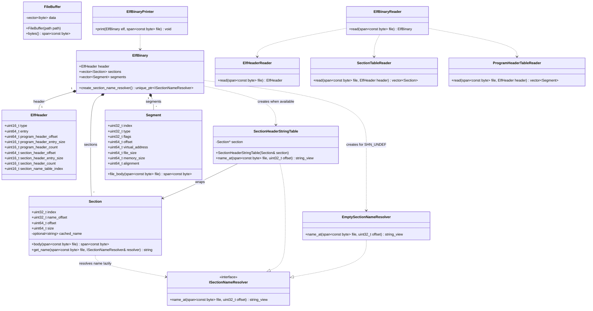

# Technical Report: Refactoring
## 0. Overview
The document presents the proposed design for an object-oriented version of an ELF Binary Inspector program. The application recieves a binary file from an input source, reads metadata about the file, then prints relevant information from the binary. The design prioritizes testability and modularity.

This report explains the main requirements of the program, technical details of how those requirements are met including our proposed object-oriented architecture, and tests. This report solely deals with design, which will be implemented in a further step.

## 1. Requirements

<!--
Briefly describe the major functional requirements of your project.
- Identify what the system should do.
- Make each requirement clear and testable.
- Use requirement IDs (e.g., R1, R2, R3) for reference.
-->

| ID | Requirement |
|---|---|
| R1 | Reads and validates ELF header for magic number, class, data endianness, version, and machine architecture (supports little-endian, x86-64). |
| R2 | Reads section headers from the section header table, validating the table's offset, count, and entry size against the file bounds. |
| R3 | Reads section names from the section name table for all section headers present in binary, failing safely with empty strings if the section name table index is `SHN_UNDEF`. |
| R4 | Reads program headers from the program header table, validating the table's offset, count, and entry size against the file bounds. |
| R5 | Reads program type, offset, virtual address, file size, and memory size. |
| R6 | Prints endianness, machine architecture, class, counts, sizes, and offsets for program headers and section headers from ELF header according to the format below. |
| R7 | Prints index, name, offset, and size for all sections according to the format below. |
| R8 | Prints index, type, offset, virtual address, file size, memory size, memory access permissions, and alignment for all program headers according to the format below. |

Example Print Output:
```
FBinaryInspector.exe sample.elf 
File: sample.elf
ELF64 | little-endian | x86-64 | DYN | Entry: 0x000000
Program headers: offset=0x000040, entry_size=56, count=9
Section headers: offset=0x0004c0, entry_size=64, count=14

Sections
INDEX   NAME            OFFSET        SIZE_BYTES
0                       0x000000      0
1       .interp         0x000238      28
2       .dynsym         0x000258      24
3       .gnu.hash       0x000270      28
4       .dynstr         0x00028c      1
5       .eh_frame_hdr   0x000290      20
6       .eh_frame       0x0002a8      60
7       .text           0x0002f0      18
8       .dynamic        0x000308      128
9       .relro_padding  0x000388      3192
10      .comment        0x000388      59
11      .symtab         0x0003c8      96
12      .shstrtab       0x000428      124
13      .strtab         0x0004a4      23

Program headers
IDX   TYPE            OFFSET      VADDR      FILE_B    MEM_B   R/W/X   ALIGN
0     PHDR            0x000040    0x000040   504       504     R--     0x000008
1     INTERP          0x000238    0x000238   28        28      R--     0x000001
2     LOAD            0x000000    0x000000   740       740     R--     0x001000
3     LOAD            0x0002f0    0x0012f0   18        18      R-X     0x001000
4     LOAD            0x000308    0x002308   128       3320    RW-     0x001000
5     DYNAMIC         0x000308    0x002308   128       128     RW-     0x000008
6     0x6474e552      0x000308    0x002308   128       3320    R--     0x000001
7     0x6474e550      0x000290    0x000290   20        20      R--     0x000004
8     0x6474e551      0x000000    0x000000   0         0       RW-     0x000000
```

## System Design

<!--
Describe how you plan to organize your project using C++ classes. Your design should include:

- **Major classes:** Explain the responsibility, important data members, and main functions/interfaces of each class.
- **Class relationships:** Provide a UML class diagram or equivalent diagram showing how the classes are related (e.g., composition, inheritance, or usage).
- **Class interactions:** Explain how the classes work together to implement the major system functionality.

Include representative C++ class declarations where helpful.

Focus on explaining **how your design satisfies the requirements**, rather than simply listing classes and functions.
-->

`ElfHeaderReader` validates the ELF header (R1) and creates an `ElfHeader` object. `SectionTableReader` creates a vector of `Section` objects for each section header in the section header table (R2). `ProgramHeaderTableReader` creates a vector of `Segment` objects for each program header in the program header table (R4). `ElfBinaryReader` orchestrates all of the previously described work to create a complete `ElfBinary`.

`ElfBinaryPrinter` uses an `ElfBinary` to print values from the header (R6), each section (R7), and each segment (R8). Section names are resolved lazily using an implementation of `ISectionNameResolver`: `SectionheaderStringTable` reads section names from the section name table if available, otherwise `EmptySectionNameResolver` resolves empty strings when the section name table index is `SHN_UNDEF` (R3).



## Test Design

<!--
Design tests to verify the major requirements and system functionality. For each test, provide:

- **Target:** The requirement or component being tested.
- **Input/Setup:** The input or conditions required.
- **Expected Result:** The expected behavior or output.

Include normal cases and important error/edge cases.

Briefly explain how your planned tests cover the major requirements.

You only need to design the tests in this milestone. They will be implemented and executed in the final milestone.
-->

The tests are based on the requirements listed above and include both singular component tests and integrated or end-to-end tests. Singular component tests include things like ensuring a segment can be created using the factory, or that a name can be retrieved from the section name table. 

End-to-end tests include things like ensuring that all metadata desired is printed when the program is given an ELF Binary file. The following test cases specify expected behavior and will be implemented in a further step:

### Planned Test Cases

| Test ID | Target/Setup | Expected Result |
|---|---|---|
| T1 | **Target:** ELF header validation.<br>**Setup:** Provide a valid little-endian x86-64 ELF file, followed by invalid files (e.g., wrong magic number, 32-bit class, or wrong endianness). | The valid file parses successfully, while the invalid files throw an appropriate exception. |
| T2 | **Target:** Section size and offset extraction.<br>**Setup:** Parse a valid ELF file with known section sizes and offsets. | The extracted `offset` and `size` values match the known binary properties exactly. |
| T3 | **Target:** Section name resolution and `SHN_UNDEF` handling.<br>**Setup:** Parse an ELF file with a valid section name table, and another where `e_shstrndx` is set to `SHN_UNDEF`. | Valid names are resolved correctly, and the `SHN_UNDEF` file safely assigns empty strings to section names without crashing. |
| T4 | **Target:** Program header bounds validation.<br>**Setup:** Parse an ELF file with valid program headers, and another with a corrupted `e_phentsize` or `e_phnum` that exceeds file bounds. | Valid headers are read successfully, while out-of-bounds configurations throw a safe runtime exception. |
| T5 | **Target:** Program header property extraction.<br>**Setup:** Parse an ELF file with known program header values. | The program type, offset, virtual address, file size, and memory size exactly match the expected binary properties. |
| T6 | **Target:** Segment struct population.<br>**Setup:** Pass valid program header data into the segment mapping logic. | The resulting `Segment` structs correctly store all mapped attributes from the parsed data. |
| T7 | **Target:** ELF header formatting and printing.<br>**Setup:** Invoke the print function with a fully populated `ElfHeader` object. | The console output exactly matches the required header formatting and values. |
| T8 | **Target:** Section struct formatting and printing.<br>**Setup:** Invoke the print function with a vector of populated `Section` structs. | The console output correctly formats and displays the index, name, offset, and size for all sections. |
| T9 | **Target:** Segment struct formatting and printing.<br>**Setup:** Invoke the print function with a vector of populated `Segment` structs. | The console output correctly formats and displays all specified properties for all segments. |